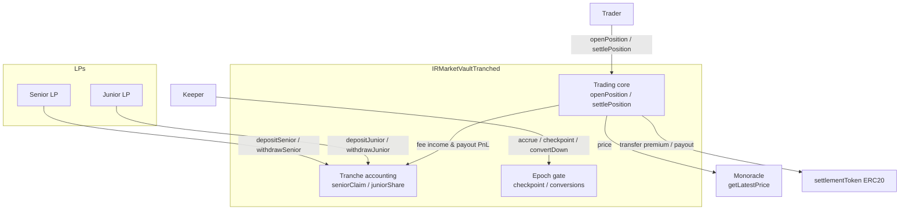
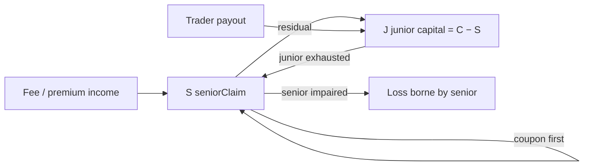
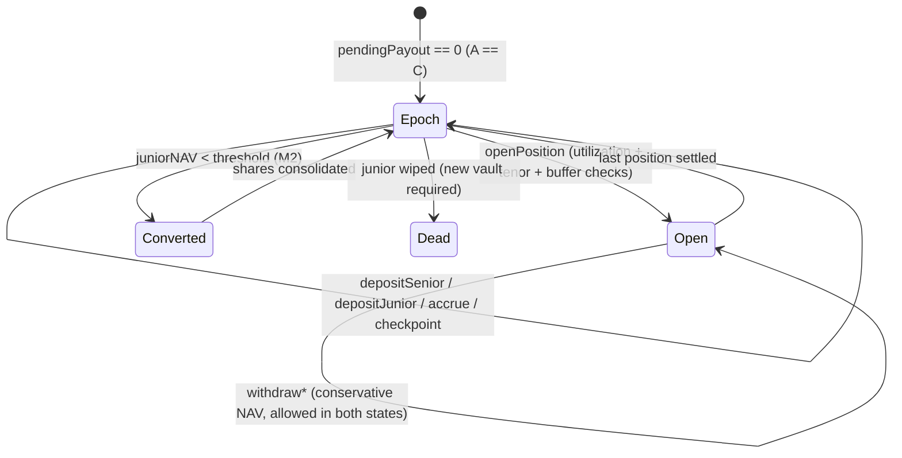

# LP Vault Tranching — Implementation Plan

**Status:** Draft for implementation review — **rev 2**, 2026-10-25 (fixes the admission math, the deposit share formula, the coupon accrual room and the epoch lock-up in rev 1)
**Worktree:** `feat/lp-tranche` (based on `9ebb0ed` / `origin/main`)
**Design input:** `docs/design/lp-pool-tranche-design.md` (product intent; both docs now agree on the admission math — see §1.3 / D4)
**Current implementation:** `contracts/IRMarketVault.sol` (246 lines, MVP), `test/IRMarketVault.test.js` (474 lines), `test/IRMarketVault.e2e.test.js` (385 lines)

---

## 0. Summary

Ship a **new** `IRMarketVaultTranched` contract alongside the existing MVP:

- Two share classes in one vault: **Senior** (fixed coupon, priority) and **Junior** (first-loss, residual).
- Launch params: Senior:Junior **1:1 (2×)**, junior floor **3333 bps**, utilization cap **5000 bps**, senior coupon **4–8% APR** (immutable).
- Trader interface unchanged (`openPosition` / `settlePosition` / `positions`), so the trading UX does not change; opens gain a utilization cap and a tenor cap.
- **Deposits** are epoch-gated (`pendingPayout == 0`), which removes the §6.5 dilution window. **Withdrawals** are always open and pay the conservative NAV, so no trader can freeze LP exits.
- Ship in three milestones: **M1 core accounting**, **M2 conversions/impairment**, **M3 frontend/deploy**.

---

## 1. Current-code audit

### 1.1 What exists (MVP)

| Area | Implementation | Lines |
|---|---|---|
| Single share class | `totalShares`, `shares[address]` | 66–68 |
| Deposit | `shares = amount × supply / equity`, supply 0 ⇒ 1:1, `eq == 0` ⇒ `DepositAtZeroEquity` | 125–140 |
| Withdraw | `amount = shares × equity / supply`, instant (even with open positions) | 142–154 |
| Open | fee = `D × feeBps / 10_000`; N = D − fee; maxPayout = 2N; `pendingPayout ≤ balance` | 160–200 |
| Settle | at/after expiry, canonical price, payout ∈ [0, 2N], release reservation | 206–222 |
| Payoff | `pnl = ±N × |Δ|/entry`, clamp [−N, +N], payout = N + pnl | 228–245 |
| Equity | `balance − pendingPayout` (conservative) | 109–111 |

### 1.2 Gaps vs the tranche design

1. No second share class, no senior claim/coupon, no waterfall.
2. No epoch gating: current `withdraw` runs while positions are open, which is exactly the dilution window we must close for two NAVs.
3. No junior ratio / buffer admission checks, no utilization cap, no tenor cap.
4. No conversion / impairment machinery.
5. Frontend assumes a single `totalShares`/`shares`/`deposit`/`withdraw` ABI.

### 1.3 Measuring junior capital: on `C`, never on `A` (D4)

The design (§1) defines `J = max(0, C − S)` on **capital** (`C = balance`) and applies the
3333-bps ratio to deposits/withdrawals only. An earlier draft of this plan read it as
`J = A − S` with `A = balance − pendingPayout` and applied the ratio at open. That version is
unusable: at open `A` drops by ≈ N (the worst-case reservation), so with S = J = 500 a 50%
floor would block **every** open, and a 33.3% floor would cap a single open at ≈ 25% of capital.
The design was right; the draft was wrong. The rule below is what both docs now say.

Two measures, strictly separated:

- `C = balance` — total capital (senior + junior + trader deposits). Used for `J`, the deposit
  ratio floor, the coupon room, and both **claim** NAVs.
- `A = balance − pendingPayout` — conservative net equity. Used **only** for the **withdrawal**
  NAV, and never for share issuance or risk limits.

| operation | rule |
|---|---|
| deposit senior / junior | epoch (`pendingPayout == 0`) **and** `J × 10_000 ≥ minJuniorRatioBps × C` |
| withdraw senior / junior | any time, at the conservative NAV; **no** ratio rule (D9) |
| open | `pendingPayout + maxPayout ≤ (balance + D) × maxUtilizationBps / 10_000` **and** optional `J × 10_000 ≥ juniorBufferBps × pendingPayout` |
| settle | waterfall by construction (`S` fixed, `J = C − S`) |

Capacity of a single open (`C = 1000`, `S = J = 500`, `f = 1%`, empty book):

| controls | max `D` |
|---|---|
| solvency only (`pending ≤ balance`) | `C/(1−2f)` ≈ **1,020** |
| **utilization 5 000** | ≈ **338** |
| utilization 10 000 + buffer 100% | ≈ **510** |
| utilization 5 000 + buffer 100% | ≈ 338 (utilization binds) |

**Buffer math (rev 1 was wrong).** The premium itself becomes junior capital
(`J_open = C − S + D`), so `C − S + D ≥ b · 2D(1 − f)` gives

```
D ≤ (C − S) / (2b(1 − f) − 1)      when 2b(1 − f) > 1
otherwise the buffer never binds
```

With `f = 1%` a buffer only starts to bite above `b ≈ 50.5%`, and at exactly Senior:Junior =
1:1 `buffer = 100%` coincides with `utilizationCapBps = 5 000`. Rev 1's `D ≤ (C − S)/(1 − 2b(1 − f))`
inverted the denominator and produced two wrong table rows (it claimed a 75% buffer binds
*before* solvency — it does not). Consequences for M1: **utilization is the default open-time
control, `juniorBufferBps` ships as 0**, and the buffer is kept only as an overlay for when the
senior share exceeds 50%.

So the 3333-bps floor is a **deposit-time capital rule**; utilization is the **open-time risk
rule**. This keeps the design's intent and avoids a structurally unopenable vault.

---

## 2. Design decisions

| # | Decision | Rationale |
|---|---|---|
| D1 | **New contract** `IRMarketVaultTranched.sol`; keep `IRMarketVault.sol` untouched | Existing tests stay green; review diff is explicit; old vault remains as MVP/reference; testnet A/B possible |
| D2 | **Deposits epoch-gated** (`pendingPayout == 0`) | Two NAVs + conservative `A` otherwise create dilution arbitrage; also closes §6.5 |
| D3 | **Fixed coupon**, immutable at deploy, non-cumulative | Ownerless; no admin setter over LP terms; arrears would crush junior |
| D4 | **`J` measured on `C = balance`; `A` only prices withdrawals** (see §1.3) | The design's rule, made explicit; `J = A − S` would block every open |
| D5 | **M1 has no hard conversion**; M2 adds down-conversion with lazy share scaling | Consolidating junior shares without iterating holders needs a scale/epoch mechanism; keep M1 shippable |
| D6 | **Trader interface unchanged** | Frontend/trader flow and bot need no changes; only LP side is new |
| D7 | Params immutable; new terms = new vault | Consistent with "new oracle = redeploy" and LP-D6 |
| D8 | **`maxUtilizationBps = 5000`** open-time cap (immutable; `10_000` = off) | Guarantees `A ≥ C/2`, so the senior conservative NAV cannot collapse because a book is open; tech-spec LP-09 |
| D9 | **Withdrawals anytime at the conservative NAV; no ratio rule on withdrawal** | `pendingPayout == 0` is third-party-controlled (a dust position with a long tenor), so gating exits is a lock-up DoS. A conservative-NAV payout is proportional, cannot over-pay, cannot break solvency, and preserves the per-share cushion |
| D10 | **Coupon room = `C − S`** (junior capital), not `A − S` | `A` is depressed by the worst-case reservation at every open, so an `A`-based room silently zeroes the senior yield exactly when the vault is busy |
| D11 | **`maxTenorBlocks = 600`** tenor cap | Makes a flat epoch always reachable (~3 min @300 ms) and bounds the settlement window; tech-spec §7 |

---

## 3. Architecture

### 3.1 Contract & actors



### 3.2 Capital waterfall



### 3.3 Epoch / conversion state machine



Deposits and conversions need a flat epoch; **withdrawals never do** (D9).

### 3.4 Open → settle sequence

```mermaid
sequenceDiagram
    participant T as Trader
    participant V as Vault
    participant O as Monoracle
    T->>V: openPosition(side, D, tenor)
    V->>V: accrue coupon
    V->>O: getLatestPrice
    V->>V: require tenor ≤ maxTenorBlocks
    V->>V: fee = D·feeBps; N = D−fee; maxPayout = 2N
    V->>V: require pending+maxPayout ≤ (balance+D)·utilBps/10000
    V->>V: require J·10000 ≥ bufferBps·(pending+maxPayout)   (if buffer > 0)
    T->>V: settlePosition(id) after expiry
    V->>O: getLatestPrice
    V->>V: payout ∈ [0,2N]; pending −= maxPayout; balance −= payout
    Note over V: junior absorbs first; senior only if C < S
```

---

## 4. State & interface

### 4.1 Storage

```solidity
contract IRMarketVaultTranched is ReentrancyGuard {
    using SafeERC20 for IERC20;

    enum Side { LONG, SHORT }
    enum Status { OPEN, SETTLED }

    struct Position {
        address owner; Side side;
        uint256 deposit; uint256 fee; uint256 notional;
        uint256 entryPrice; uint256 maxPayout;
        uint64 expiryBlock; Status status;
    }

    // immutables
    IMonoracle public immutable oracle;
    address public immutable priceBase;
    address public immutable settlementToken;
    uint256 public immutable feeBps;
    uint16  public immutable seniorCouponBps;    // 400–800
    uint16  public immutable minJuniorRatioBps;  // 3333  (deposit rule)
    uint16  public immutable maxUtilizationBps;  // 5000  (open rule)
    uint16  public immutable juniorBufferBps;    // 0 = off (open rule, optional)
    uint32  public immutable maxTenorBlocks;     // 600
    uint32  public immutable blocksPerYear;      // 105_120_000 @300ms

    // trading
    uint256 public balance;          // cached token balance == ERC20 balanceOf
    uint256 public pendingPayout;    // Σ OPEN maxPayout
    Position[] private _positions;

    // tranches
    uint256 public seniorShares;
    uint256 public juniorShares;
    mapping(address => uint256) public seniorSharesOf;
    mapping(address => uint256) public juniorSharesOf;
    uint256 public seniorPrincipal;  // coupon base (deposits, not claim)
    uint256 public seniorClaim;      // principal + accrued coupon
    uint256 public lastAccrualBlock;

    // epoch snapshot (checkpoint) — display only, gates nothing
    uint256 public lastEpochBlock;
    uint256 public epochSeniorNav;   // WAD
    uint256 public epochJuniorNav;   // WAD
}
```

Constructor validation (revert `InvalidConfig`), all params immutable:
`seniorCouponBps ≤ 2_000`, `minJuniorRatioBps < 10_000`, `1_000 ≤ maxUtilizationBps ≤ 10_000`,
`juniorBufferBps ≤ 10_000`, `maxTenorBlocks > 0`, `feeBps < 10_000`, non-zero addresses; sets
`lastAccrualBlock = block.number`.

M2 adds `downConvertBps` / `upConvertBps` and conversion storage, which changes the constructor —
so M1 and M2 are separate testnet deployments with no LP migration. That is acceptable only
because nothing is live before M3; if real deposits land on M1, reserve those slots now.

### 4.2 Views

```solidity
// -- claim NAVs (what an LP owns; used by deposits and the UI) --
function seniorNAV() external view returns (uint256);        // S*1e18/seniorShares; 1e18 if supply 0
function juniorNAV() external view returns (uint256);        // J*1e18/juniorShares; 1e18 if supply 0
// -- conservative NAVs (what a withdrawal pays right now) --
function seniorNAVConservative() external view returns (uint256);  // min(S,A)*1e18/seniorShares
function juniorNAVConservative() external view returns (uint256);  // max(0,A-S)*1e18/juniorShares
// -- capital & risk --
function equity() external view returns (uint256);           // balance − pendingPayout (A)
function juniorCapital() external view returns (uint256);    // max(0, balance − seniorClaim) (J)
function juniorRatio() external view returns (uint256);      // J*1e18/balance
function utilization() external view returns (uint256);      // pendingPayout*1e18/balance
function bufferRatio() external view returns (uint256);      // J*1e18/pendingPayout (0 if none)
function juniorLeverage() external view returns (uint256);   // balance*1e18/J (0 if J == 0)
function couponCoverage() external view returns (uint256);   // J*1e18/annualCoupon (years of cushion)
function pendingCoupon() external view returns (uint256);    // accrual since lastAccrualBlock
// -- epoch --
function canDeposit() external view returns (bool);          // pendingPayout == 0
function epochSeniorNav() external view returns (uint256);   // snapshot
function epochJuniorNav() external view returns (uint256);   // snapshot
function positionCount() external view returns (uint256);
function positions(uint256 id) external view returns (Position memory);
```

`couponCoverage` = `J × 1e18 / annualCoupon`: how many years of coupon the junior cushion can
pay with zero income (the design's coverage idea, in the unit LPs can act on). Every view must
be defined at zero supply and zero pending.

### 4.3 Functions

```solidity
function depositSenior(uint256 amount) external returns (uint256 shares);   // epoch only
function depositJunior(uint256 amount) external returns (uint256 shares);   // epoch only
function withdrawSenior(uint256 shareAmount) external returns (uint256 amount); // any time, conservative NAV
function withdrawJunior(uint256 shareAmount) external returns (uint256 amount); // any time, conservative NAV
function accrue() external;                                  // permissionless
function checkpoint() external;                              // permissionless, epoch only, snapshots NAVs
function openPosition(Side side, uint256 depositAmount, uint64 tenorBlocks) external returns (uint256 id);
function settlePosition(uint256 positionId) external returns (uint256 payout);

// M2
function convertDown() external;                             // permissionless, epoch-only
```

### 4.4 Events / errors

Events: `SeniorDeposited(lp, amount, shares)`, `JuniorDeposited`, `SeniorWithdrawn`, `JuniorWithdrawn`,
`CouponAccrued(amount, seniorClaim)`, `EpochCheckpoint(blockNumber, seniorNav, juniorNav)`, `SeniorImpaired(shortfall)`,
`DownConversion(oldShares, newShares)` (M2), plus the existing `PositionOpened` / `PositionSettled`.

Errors: `InvalidConfig`, `ZeroAmount`, `ZeroTenor`, `ZeroShares`, `PriceUnavailable`, `Insolvent`,
`JuniorBufferBreached`, `JuniorRatioBreached`, `UtilizationBreached`, `TenorTooLong`,
`EpochNotReady`, `DepositAtZeroNAV`, `InsufficientShares`, `NotOpen`, `NotExpired`, `NoConversion` (M2).

---

## 5. Function specifications

### 5.1 Coupon accrual (`_accrue`)

```solidity
uint256 dt = block.number - lastAccrualBlock;
if (dt == 0) return;
lastAccrualBlock = block.number;
if (seniorPrincipal == 0) return;

uint256 room = balance > seniorClaim ? balance - seniorClaim : 0;   // = J, junior capital
if (room == 0) return;                                             // junior exhausted (non-cumulative)
uint256 coupon = seniorPrincipal * seniorCouponBps * dt / (10_000 * blocksPerYear);
if (coupon == 0) return;
if (coupon > room) coupon = room;
seniorClaim += coupon;
emit CouponAccrued(coupon, seniorClaim);
```

Notes:
- **Room is `C − S` (`= J`), not `A − S`** (D10). `A` is `balance − pendingPayout`; with the
  worst-case reservation that number is depressed at every open, so an `A`-based room stops
  accrual whenever the book reserves more than the junior cushion — i.e. in normal operation.
  Rooming on `C` keeps `S ≤ C` (junior can never go negative) and leaves solvency untouched
  (`pendingPayout ≤ balance` does not reference `S`).
- Rounding floors (favours pool).
- Accrual stops at `J = 0` and does **not** back-fill (non-cumulative, D3).
- Called at the top of every external state-changing function.

### 5.2 Senior deposit

```solidity
_accrue();
if (amount == 0) revert ZeroAmount();
if (pendingPayout != 0) revert EpochNotReady();          // D2

uint256 nav = seniorShares == 0 ? 1e18 : seniorNAV();    // claim NAV
if (seniorShares > 0 && nav == 0) revert DepositAtZeroNAV();
uint256 shares = amount * 1e18 / nav;                    // rev 1 wrote amount*seniorShares/nav (wrong by supply/1e18)
if (shares == 0) revert ZeroShares();

IERC20(settlementToken).safeTransferFrom(msg.sender, address(this), amount);
balance += amount;
seniorPrincipal += amount;
seniorClaim += amount;
seniorShares += shares;
seniorSharesOf[msg.sender] += shares;

uint256 J = balance - seniorClaim;
if (J * 10_000 < minJuniorRatioBps * balance) revert JuniorRatioBreached();   // deposit rule

emit SeniorDeposited(msg.sender, amount, shares);
```

### 5.3 Junior deposit

```solidity
_accrue();
if (amount == 0) revert ZeroAmount();
if (pendingPayout != 0) revert EpochNotReady();

uint256 nav = juniorShares == 0 ? 1e18 : juniorNAV();
if (juniorShares > 0 && nav == 0) revert DepositAtZeroNAV();
uint256 shares = amount * 1e18 / nav;
if (shares == 0) revert ZeroShares();

IERC20(settlementToken).safeTransferFrom(msg.sender, address(this), amount);
balance += amount;
juniorShares += shares;
juniorSharesOf[msg.sender] += shares;

emit JuniorDeposited(msg.sender, amount, shares);
```

Share scale check: with `nav = V·1e18/T`, `amount·1e18/nav = amount·T/V` — the correct
pro-rata mint. At par (`T = V`) a deposit of `a` mints `a`, and one share is one token unit.

### 5.4 Withdrawals (any time, conservative NAV, no ratio rule)

```solidity
// senior
_accrue();
if (shareAmount == 0) revert ZeroAmount();
if (shareAmount > seniorSharesOf[msg.sender]) revert InsufficientShares();
uint256 nav = seniorNAVConservative();                  // min(S, A) * 1e18 / seniorShares
uint256 amount = shareAmount * nav / 1e18;
if (amount == 0) revert ZeroAmount();

uint256 principalOut = seniorPrincipal * shareAmount / seniorShares;
seniorSharesOf[msg.sender] -= shareAmount;
seniorShares -= shareAmount;
seniorPrincipal -= principalOut;
seniorClaim -= amount;                                  // claim falls by exactly what was paid
balance -= amount;
safeTransfer(msg.sender, amount);

// junior — note: when A < S the conservative NAV is 0 and the withdrawal reverts
// `ZeroAmount`; the holder must wait for a flat block (waiting is strictly better).

// junior
_accrue();
if (shareAmount == 0) revert ZeroAmount();
if (shareAmount > juniorSharesOf[msg.sender]) revert InsufficientShares();
uint256 amount = shareAmount * juniorNAVConservative() / 1e18;
if (amount == 0) revert ZeroAmount();
juniorSharesOf[msg.sender] -= shareAmount;
juniorShares -= shareAmount;
balance -= amount;
safeTransfer(msg.sender, amount);
```

Safety argument (why no epoch gate, no ratio check): `juniorNAVConservative` divides
`max(0, A − S)` and `seniorNAVConservative` divides `min(S, A)`, so the sum of all redeemable
value at any instant is `≤ A = balance − pendingPayout`. A withdrawal therefore cannot break
`pendingPayout ≤ balance`, and because it is exactly pro-rata it removes the withdrawer's own
slice of cushion — per-share cushion (`(A − S)/supply`, `min(S, A)/supply`) is unchanged, so
incumbents are not diluted and a run cannot extract value from the book. **There is no
`JuniorRatioBreached` on the withdrawal path**: the ratio rule is a deposit rule (D9), which is
what keeps junior exits from being blocked in a stressed vault.

Senior impairment edge case: when `C < S`, `nav = C × 1e18 / seniorShares`, so the exiting
holder receives exactly their pro-rata slice of capital and `seniorClaim` falls by the same
amount. Token value per share for the holders who stay is unchanged (`(C − a)/shares'`), the
claim stays impaired, and junior is already zero — no class gains or loses from the ordering.
Test this explicitly.

### 5.5 Checkpoint / accrue

```solidity
function accrue() external { _accrue(); }

function checkpoint() external {                 // snapshots only; gates nothing
    _accrue();
    if (pendingPayout != 0) revert EpochNotReady();
    lastEpochBlock = block.number;
    epochSeniorNav = seniorShares == 0 ? 1e18 : seniorNAV();
    epochJuniorNav = juniorShares == 0 ? 1e18 : juniorNAV();
    emit EpochCheckpoint(block.number, epochSeniorNav, epochJuniorNav);
}
```

`checkpoint()` is permissionless and is the only source of a *stable* NAV for the UI: live
`seniorNAVConservative` dips whenever a book is open (that is the reservation, not a loss), so
the frontend must show `epochSeniorNav` / `epochJuniorNav` as "NAV" and the conservative pair
as "exit value now".

### 5.6 Open (trader path unchanged, controls added)

```solidity
_accrue();
if (depositAmount == 0) revert ZeroAmount();
if (tenorBlocks == 0) revert ZeroTenor();
if (tenorBlocks > maxTenorBlocks) revert TenorTooLong();          // D11

(uint256 entryPrice, , bool exists) = oracle.getLatestPrice(priceBase, settlementToken);
if (!exists || entryPrice == 0) revert PriceUnavailable();

uint256 fee = depositAmount * feeBps / 10_000;
uint256 notional = depositAmount - fee;
uint256 maxPayout = notional * 2;                 // MAX_PROFIT_BPS = 10_000

safeTransferFrom(msg.sender, address(this), depositAmount);
balance += depositAmount;

uint256 newPending = pendingPayout + maxPayout;
if (newPending > balance) revert Insolvent();

// D8: utilization cap — keeps A >= (1 - cap) * balance at all times
if (maxUtilizationBps < 10_000) {
    if (newPending * 10_000 > balance * maxUtilizationBps) revert UtilizationBreached();
}

// D4/optional overlay
uint256 J = balance - seniorClaim;
if (juniorBufferBps != 0 && J * 10_000 < juniorBufferBps * newPending) {
    revert JuniorBufferBreached();
}

pendingPayout = newPending;
// push position, emit PositionOpened (same as MVP)
```

The utilization check uses `balance` **after** the premium transfer — i.e. `(C + D)` from the
design's formula; both spellings are the same number here.

Capacity with `C = 1000, f = 1%`: solvency ⇒ `D ≤ 1,020`; utilization 5 000 ⇒ `D ≤ 338`;
buffer 100% (with `S = 500`) ⇒ `D ≤ 510`, so utilization binds. See §1.3.

### 5.7 Settle (waterfall is implicit)

```solidity
_accrue();
Position storage p = _positions[positionId];
if (p.status != Status.OPEN) revert NotOpen();
if (block.number < p.expiryBlock) revert NotExpired();

(uint256 settlePrice, , bool exists) = oracle.getLatestPrice(priceBase, settlementToken);
if (!exists || settlePrice == 0) revert PriceUnavailable();

uint256 payout = _payout(p, settlePrice);          // identical to MVP

p.status = Status.SETTLED;
pendingPayout -= p.maxPayout;
balance -= payout;
safeTransfer(p.owner, payout);
emit PositionSettled(positionId, settlePrice, payout);

// no explicit waterfall: S is fixed, J = balance - S; junior absorbed first by construction
```

### 5.8 Down conversion (M2)

M1 ships without it (junior NAV can drift; new deposits buy at current NAV, which economically resets leverage).
M2 must solve holder iteration. Proposed approach: **lazy scaled shares**

```
juniorShares (raw) + juniorShareScale (WAD, starts 1e18)
effectiveSupply = juniorShares * juniorShareScale / 1e18
juniorNAV = J * 1e18 / effectiveSupply
convertDown: juniorShareScale = J * 1e18 / juniorShares   // effective supply = J, NAV = 1
deposit/withdraw: convert raw <-> effective via the scale
```

This avoids iterating holders and keeps balances in raw units. Edge cases (J=0 wipe, scale reset) need a generation/epoch field or a "dead vault" path; specify in M2 design review.

---

## 6. Formulas, rounding & limits

```
fee            = D * feeBps / 10_000                    // floor
notional N     = D - fee
maxPayout      = 2 * N                                  // payout ∈ [0, 2N]
coupon         = min(principal * couponBps * Δblocks / (10_000 * blocksPerYear), C - S)   // floor
seniorNAV      = S * 1e18 / seniorShares                // claim
juniorNAV      = J * 1e18 / juniorShares                // claim
seniorNAVConserv = min(S, A) * 1e18 / seniorShares      // withdrawal
juniorNAVConserv = max(0, A - S) * 1e18 / juniorShares  // withdrawal
deposit shares = amount * 1e18 / nav                    // floor
withdraw amt   = shares * navConserv / 1e18             // floor
capital ratio  = J * 10_000 / C            ≥ minJuniorRatioBps      (deposits)
utilization    = (pending + maxPayout) * 10_000 / balance ≤ maxUtilizationBps   (opens)
book buffer    = J * 10_000 / pendingPayout ≥ juniorBufferBps (if > 0)           (opens)
```

Max single open (no prior pending), ignoring fee rounding:

```
solvency:     D ≤ C / (1 − 2f)
utilization:  D ≤ cap·C / (2(1 − f) − cap)
buffer:       D ≤ (C − S) / (2b(1 − f) − 1)      (when 2b(1 − f) > 1; else never binds)
```

Example `C=1000, S=500, f=1%, cap=50%`: solvency ⇒ 1,020; utilization ⇒ 338;
buffer 100% ⇒ 510; buffer 50% ⇒ never binds (needs `b > 50.5%`).

---

## 7. Test plan

### 7.1 Unit (`test/IRMarketVaultTranched.test.js`)

- constructor validation (zero addresses, coupon ≥ max, ratio ≥ 10 000, utilization out of range, tenor cap 0).
- senior/junior deposit 1:1: shares, claim NAVs, `seniorClaim`, `juniorCapital`.
- **deposit mint math**: at par, `deposit(500)` mints 500 shares for both classes; after a coupon/fee rise (`nav > 1e18`) a deposit mints `amount·1e18/nav` and `ZeroShares` guards tiny amounts (this is the rev-1 formula bug).
- coupon accrual over N blocks (no positions): exact expected floor value; `pendingCoupon` view.
- **coupon accrues while a book is open** (room is `C − S`, not `A − S`): with a position reserving more than `J`, accrual continues.
- coupon stops at `J == 0` (wiped junior) and does not back-fill when junior returns.
- deposits revert `EpochNotReady` while a position is OPEN; **withdrawals succeed** while a position is OPEN and pay the conservative NAV.
- **withdraw-while-open is pro-rata/no-dilution**: withdraw mid-book, settle at max, remaining per-share value equals the never-withdrawn control case.
- senior deposit respects the 3333-bps floor (`JuniorRatioBreached`) — at C=1000/S=500, max +500.
- junior withdraw that would breach the floor still succeeds (deposit-only rule) and subsequent senior deposits revert until junior is topped up.
- open: fee/N/maxPayout; `Insolvent` when uncovered; `UtilizationBreached` at cap 5000 (D=338 ok, D=400 reverts); `TenorTooLong` above `maxTenorBlocks`; `JuniorBufferBreached` only with buffer ≥ ~51% and tight J.
- **stale-frame regression**: `pendingPayout != 0` must not be reachable as a DoS on exits — dust open → both classes still withdraw.
- settle flat: `C += fee`; junior NAV up; senior coupon accrued.
- settle big win: junior absorbs first; `seniorNAV == 1` while `C ≥ S`.
- settle loss beyond junior: junior wiped, `seniorNAV < 1`; coupon stops.
- permissionless settle; payout to owner.
- payoff boundaries from MVP (`S=2·S0`, `S=5·S0`, `S=1 wei`, `S=0` rejected, overflow panic).
- senior withdraw at impaired NAV; `seniorPrincipal` proportional reduction; impairment is not cured and junior is untouched.
- `checkpoint()` snapshots NAVs and is a no-op for accounting; `epochSeniorNav` unaffected by a later open.
- views at zero supply (`seniorNAV`/`juniorNAV` == 1e18) and zero pending (`bufferRatio` == 0).
- token balance == cached `balance` at all times.
- invariants: `pendingPayout ≤ balance`; `J == max(0, balance − seniorClaim)`; `Σ seniorSharesOf == seniorShares`; `Σ juniorSharesOf == juniorShares`; `A == C` at every epoch; `S ≤ C + J`.
- deterministic fuzz (port MVP fuzz, add tranche ops; expected reverts include new errors).

### 7.2 M2 tests

- down conversion at epoch: `jNAV < 0.25` ⇒ effective supply = J, NAV = 1; leverage reset.
- conversion blocked while positions open (`EpochNotReady`).
- junior-scale math across deposit/withdraw before/after conversion.
- wipe path: J=0 ⇒ vault dead (no new deposits); senior impaired event.

### 7.3 Integration / e2e

- `test/IRMarketVault.e2e.test.js` equivalent with tranches: deploy → senior/junior deposit → open → settle → withdraw → assert balances.
- Frontend unit tests for NAV/coupon formatting (`web/src/lib/vault.test.ts`).
- Gas snapshot: compare open/settle/deposit/withdraw vs MVP.

---

## 8. Frontend, scripts, docs

| Path | Change |
|---|---|
| `web/src/lib/abis/vault.ts` | new ABI (tranche functions/views/events/errors) |
| `web/src/lib/vault.ts` | NAV/coupon/ratio formatting + math helpers |
| `web/src/lib/vault.test.ts` | unit tests for helpers |
| `web/src/hooks/useVault.ts` | new read hooks: `seniorNAV`/`juniorNAV` (claim), `*NAVConservative` (exit), `epochSeniorNav`/`epochJuniorNav`, `juniorRatio`, `utilization`, `bufferRatio`, `pendingCoupon`, `canDeposit` |
| `web/src/hooks/useVaultTrade.ts` | unchanged (trader path) |
| `web/src/components/vault/LPPanel.tsx` | tranche tabs (Senior / Junior): epoch NAV as headline, conservative NAV as "exit now", coupon + leverage + utilization, "deposits paused while a book is open" notice, deposit/withdraw forms |
| `web/src/app/vault/page.tsx` | pass tranche data to `LPPanel` |
| `script/deploy-vault.js` | deploy `IRMarketVaultTranched` with params; local demo |
| `script/deploy.js` | testnet deploy; write `deployment.json` |
| `deployment.json` / web env | new vault address (`NEXT_PUBLIC_VAULT_ADDRESS`) |
| `docs/design/lp-pool-tech-spec.md` | §6/§7 note pointing to the tranche spec |
| `docs/design/lp-pool-frontend-design.md` | LP panel section: two tranches |
| `todo.md` | add the GH issue line (index convention) |

Not in scope: bot (no vault dependency), v0.9 veto wrapper, premium-pricing engine.

---

## 9. Milestones & task checklist

### M1 — core tranche accounting (this issue, first PR)
- [ ] `contracts/IRMarketVaultTranched.sol` skeleton + constructor (validated params) + storage
- [ ] `_accrue` (room = `C − S`) + `accrue` + `checkpoint` (epoch NAV snapshot)
- [ ] `depositSenior` / `depositJunior` (epoch-gated, `amount·1e18/nav`, ratio floor, `ZeroShares`)
- [ ] `withdrawSenior` / `withdrawJunior` (**any time**, conservative NAV, no ratio rule)
- [ ] `openPosition` with utilization cap + tenor cap + optional buffer (trader path otherwise unchanged)
- [ ] `settlePosition` with implicit waterfall
- [ ] views (claim vs conservative NAVs, ratios, epoch snapshot) + events + errors
- [ ] `test/IRMarketVaultTranched.test.js` (unit + invariants + fuzz + the rev-1 regressions)
- [ ] gas snapshot + `npx hardhat test` green (MVP suite untouched)

### M2 — conversions & impairment
- [ ] down conversion with lazy junior share scaling
- [ ] impairment event + coupon stop/resume rules
- [ ] wipe / dead-vault path (and whether a wiped vault can be recapitalised)
- [ ] M2 tests

### M3 — frontend, deploy, docs
- [ ] ABI + hooks + LP panel (two tranches, epoch vs conservative NAV)
- [ ] deploy scripts + `deployment.json` + env
- [ ] e2e + frontend tests
- [ ] docs updates (`lp-pool-tech-spec`, frontend design)
- [ ] optional request-queue withdrawal (`requestWithdraw`/`claimWithdraw`) so a full-value exit does not need to poll for a flat block
- [ ] testnet deployment + demo script

---

## 10. Risks & open questions

1. **Negative EV**: tranching redistributes, does not create edge. Do not deploy to real users until the premium pricing fix (issue #11) lands.
2. **Epoch UX**: *deposits* only when flat; withdrawals always work but at the conservative NAV, so a full-value exit wants a flat block. `maxTenorBlocks = 600` bounds that wait; the UI must explain it, and a request queue is the M3 fix.
3. **Coupon room**: accrual is capped by junior capital `J`; if junior is thin, the senior coupon is clipped (non-cumulative). This is intended but must be visible (`couponCoverage`, `pendingCoupon`).
4. **Conversion complexity** (M2): lazy scaling needs careful review for deposit/withdraw after multiple conversions; wipe path must be explicit.
5. **Rounding**: all floors favour the pool; `shares == 0` for a positive deposit now reverts `ZeroShares` (covered by a test).
6. **Frontend two-NAV display**: `seniorNAVConservative`/`juniorNAVConservative` dip purely from reservation while a book is open; never show that as a loss — headline the epoch NAV and show the conservative pair as "exit now".
7. **Param governance**: immutable; any change requires a new vault (and LP migration).
8. **Wiped vault is terminal in M1** (`J = 0` ⇒ `DepositAtZeroNAV`, ratio floor blocks new senior deposits): senior exits at `min(S, A)`, recovery needs M2 or a new vault. Disclose before any real deposit.
9. **Sequential risk**: the utilization cap bounds one book; a run of worst-case settles still walks down junior and then senior. Utilization + buffer are not a guarantee.

---

## 11. References

- Design: `docs/design/lp-pool-tranche-design.md`
- Tech spec: `docs/design/lp-pool-tech-spec.md` §4 (payoff), §6 (accounting), §7 (admission), §9 (lifecycle)
- Current contract: `contracts/IRMarketVault.sol`
- Current tests: `test/IRMarketVault.test.js`, `test/IRMarketVault.e2e.test.js`
- Premium pricing context: `docs/design/lp-pool-premium-pricing-spec.md`, `dixia/IRMarket#11`
- Related issue: `dixia/IRMarket#9` (LP capital-flow concerns)
