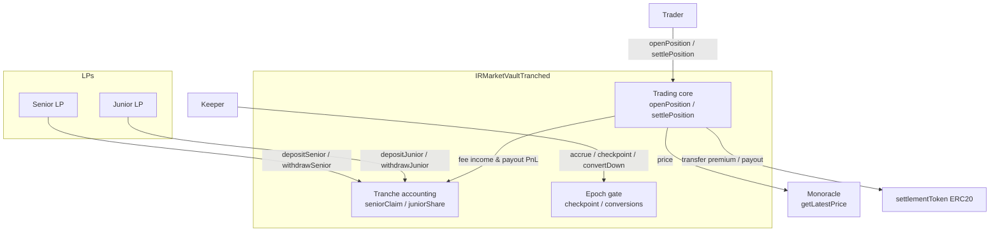
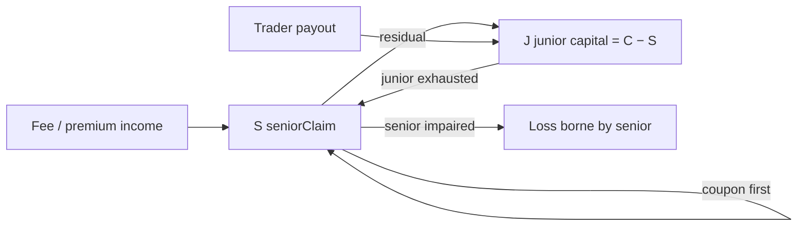
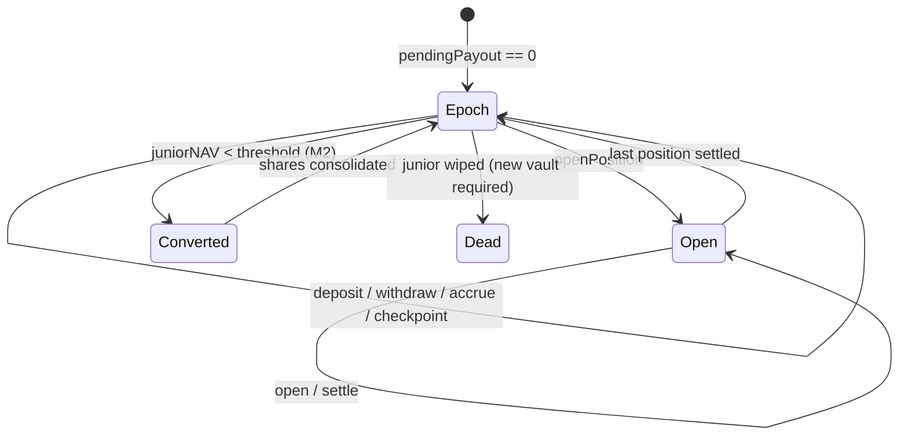

# LP Vault Tranching — Implementation Plan

**Status:** Draft for implementation review (2026-10-25)
**Worktree:** `feat/lp-tranche` (based on `9ebb0ed` / `origin/main`)
**Design input:** `docs/design/lp-pool-tranche-design.md` (product intent; this plan supersedes its admission math, see §2 D4)
**Current implementation:** `contracts/IRMarketVault.sol` (246 lines, MVP), `test/IRMarketVault.test.js` (445 lines), `test/IRMarketVault.e2e.test.js`

---

## 0. Summary

Ship a **new** `IRMarketVaultTranched` contract alongside the existing MVP:

- Two share classes in one vault: **Senior** (fixed coupon, priority) and **Junior** (first-loss, residual).
- Launch params: Senior:Junior **1:1 (2×)**, junior floor **3333 bps**, senior coupon **4–8% APR** (immutable).
- Trader interface unchanged (`openPosition` / `settlePosition` / `positions`), so the trading UX does not change.
- LP share operations are **epoch-gated** (`pendingPayout == 0`), which also removes the §6.5 dilution window.
- Ship in three milestones: **M1 core accounting**, **M2 conversions/impairment**, **M3 frontend/deploy**.

---

## 1. Current-code audit

### 1.1 What exists (MVP)

| Area | Implementation | Lines |
|---|---|---|
| Single share class | `totalShares`, `shares[address]` | 66–68 |
| Deposit | `shares = amount × supply / equity`, supply 0 ⇒ 1:1, `eq == 0` ⇒ `DepositAtZeroEquity` | 125–140 |
| Withdraw | `amount = shares × equity / supply`, instant (even with open positions) | 142–154 |
| Open | fee = `D × feeBps / 10_000`; N = D − fee; maxPayout = 2N; `pendingPayout ≤ balance` | 160–200 |
| Settle | at/after expiry, canonical price, payout ∈ [0, 2N], release reservation | 206–222 |
| Payoff | `pnl = ±N × |Δ|/entry`, clamp [−N, +N], payout = N + pnl | 228–245 |
| Equity | `balance − pendingPayout` (conservative) | 109–111 |

### 1.2 Gaps vs the tranche design

1. No second share class, no senior claim/coupon, no waterfall.
2. No epoch gating: current `withdraw` runs while positions are open, which is exactly the dilution window we must close for two NAVs.
3. No junior ratio / buffer admission checks.
4. No conversion / impairment machinery.
5. Frontend assumes a single `totalShares`/`shares`/`deposit`/`withdraw` ABI.

### 1.3 Key finding that changes the design's admission math (D4)

The design doc defined `A = balance − pendingPayout` and `J = A − S`, then required `J ≥ r × (S + J)` at open. Checked against this code, that rule is unusable during open positions: at open, `A` drops by ≈ N (the worst-case reservation), so with S=J=500 a 50% junior ratio would block **every** open, and a 33.3% ratio caps a single open at ≈ 25% of capital.

**Implementation rule:** use two measures explicitly.

- `C = balance` — total capital (senior + junior + trader deposits).
- `J = max(0, C − S)` — junior capital.
- `A = balance − pendingPayout` — conservative net equity, used **only** for epoch NAV and coupon room.
- Deposit/withdraw check the **capital ratio**: `J × 10_000 ≥ minJuniorRatioBps × C`.
- Open checks the **book buffer**: `J × 10_000 ≥ juniorBufferBps × pendingPayout` (optional; 0 = off). Solvency `pendingPayout ≤ balance` still applies.

With `C=1000, S=500, J=500`:

| check | binding max single open `D` |
|---|---|
| solvency only (`buffer=0`) | `D ≤ C/(1−2f)` ≈ 1.02C ≈ **1,020** |
| buffer 50% | ≈ `(C−S)/(1−0.99)` → solvency binds (1,020) |
| buffer 75% | ≈ **1,030** (buffer binds earlier) |
| buffer 100% (principal protection) | ≈ **510** (senior capital idle) |

So the 3333-bps floor is a **deposit-time capital rule**; the buffer is the optional **open-time risk rule**. This keeps the design's intent and avoids a structurally unopenable vault.

---

## 2. Design decisions

| # | Decision | Rationale |
|---|---|---|
| D1 | **New contract** `IRMarketVaultTranched.sol`; keep `IRMarketVault.sol` untouched | Existing tests stay green; review diff is explicit; old vault remains as MVP/reference; testnet A/B possible |
| D2 | **Epoch-gated** share ops (`pendingPayout == 0`) | Two NAVs + conservative `A` otherwise create dilution arbitrage; also closes §6.5 |
| D3 | **Fixed coupon**, immutable at deploy, non-cumulative | Ownerless; no admin setter over LP terms; arrears would crush junior |
| D4 | **Capital ratio vs book buffer** (see §1.3) | Design's `J = A − S` rule blocks any open under a 50% floor; split measures instead |
| D5 | **M1 has no hard conversion**; M2 adds down-conversion with lazy share scaling | Consolidating junior shares without iterating holders needs a scale/epoch mechanism; keep M1 shippable |
| D6 | **Trader interface unchanged** | Frontend/trader flow and bot need no changes; only LP side is new |
| D7 | Params immutable; new terms = new vault | Consistent with "new oracle = redeploy" and LP-D6 |

---

## 3. Architecture

### 3.1 Contract & actors



### 3.2 Capital waterfall



### 3.3 Epoch / conversion state machine



### 3.4 Open → settle sequence

```mermaid
sequenceDiagram
    participant T as Trader
    participant V as Vault
    participant O as Monoracle
    T->>V: openPosition(side, D, tenor)
    V->>V: accrue coupon
    V->>O: getLatestPrice
    V->>V: fee = D·feeBps; N = D−fee; maxPayout = 2N
    V->>V: require pending+maxPayout ≤ balance
    V->>V: require J·10000 ≥ bufferBps·(pending+maxPayout)
    T->>V: settlePosition(id) after expiry
    V->>O: getLatestPrice
    V->>V: payout ∈ [0,2N]; pending −= maxPayout; balance −= payout
    Note over V: junior absorbs first; senior only if C < S
```

---

## 4. State & interface

### 4.1 Storage

```solidity
contract IRMarketVaultTranched is ReentrancyGuard {
    using SafeERC20 for IERC20;

    enum Side { LONG, SHORT }
    enum Status { OPEN, SETTLED }

    struct Position {
        address owner; Side side;
        uint256 deposit; uint256 fee; uint256 notional;
        uint256 entryPrice; uint256 maxPayout;
        uint64 expiryBlock; Status status;
    }

    // immutables
    IMonoracle public immutable oracle;
    address public immutable priceBase;
    address public immutable settlementToken;
    uint256 public immutable feeBps;
    uint16  public immutable seniorCouponBps;    // 400–800
    uint16  public immutable minJuniorRatioBps;  // 3333
    uint16  public immutable juniorBufferBps;    // 0 = off
    uint32  public immutable blocksPerYear;      // 105_120_000 @300ms

    // trading
    uint256 public balance;          // cached token balance == ERC20 balanceOf
    uint256 public pendingPayout;    // Σ OPEN maxPayout
    Position[] private _positions;

    // tranches
    uint256 public seniorShares;
    uint256 public juniorShares;
    mapping(address => uint256) public seniorSharesOf;
    mapping(address => uint256) public juniorSharesOf;
    uint256 public seniorPrincipal;  // coupon base (deposits, not claim)
    uint256 public seniorClaim;      // principal + accrued coupon
    uint256 public lastAccrualBlock;
}
```

### 4.2 Views

```solidity
function equity() external view returns (uint256);          // balance − pendingPayout (A)
function seniorNAV() external view returns (uint256);        // min(S,A)*1e18/seniorShares
function juniorNAV() external view returns (uint256);        // J*1e18/juniorShares
function juniorCapital() external view returns (uint256);    // max(0, balance − seniorClaim)
function juniorRatio() external view returns (uint256);      // J*1e18/balance
function bufferRatio() external view returns (uint256);      // J*1e18/pendingPayout (0 if none)
function pendingCoupon() external view returns (uint256);    // accrual since lastAccrualBlock
function canDeposit() external view returns (bool);          // pendingPayout == 0
function positionCount() external view returns (uint256);
function positions(uint256 id) external view returns (Position memory);
```

### 4.3 Functions

```solidity
function depositSenior(uint256 amount) external returns (uint256 shares);
function depositJunior(uint256 amount) external returns (uint256 shares);
function withdrawSenior(uint256 shareAmount) external returns (uint256 amount);
function withdrawJunior(uint256 shareAmount) external returns (uint256 amount);
function accrue() external;                                  // permissionless
function checkpoint() external;                              // permissionless, requires epoch
function openPosition(Side side, uint256 depositAmount, uint64 tenorBlocks) external returns (uint256 id);
function settlePosition(uint256 positionId) external returns (uint256 payout);

// M2
function convertDown() external;                             // permissionless, epoch-only
```

### 4.4 Events / errors

Events: `SeniorDeposited(lp, amount, shares)`, `JuniorDeposited`, `SeniorWithdrawn`, `JuniorWithdrawn`,
`CouponAccrued(amount, seniorClaim)`, `EpochCheckpoint(blockNumber)`, `SeniorImpaired(shortfall)`,
`DownConversion(oldShares, newShares)` (M2), plus the existing `PositionOpened` / `PositionSettled`.

Errors: `InvalidConfig`, `ZeroAmount`, `ZeroTenor`, `PriceUnavailable`, `Insolvent`,
`JuniorBufferBreached`, `JuniorRatioBreached`, `EpochNotReady`, `DepositAtZeroNAV`,
`InsufficientShares`, `NotOpen`, `NotExpired`, `NoConversion` (M2).

---

## 5. Function specifications

### 5.1 Coupon accrual (`_accrue`)

```solidity
uint256 dt = block.number - lastAccrualBlock;
if (dt == 0) return;
lastAccrualBlock = block.number;
if (seniorPrincipal == 0) return;

uint256 A = equity();                  // balance - pendingPayout (conservative room)
if (A <= seniorClaim) return;          // no accrual while impaired/fully reserved (non-cumulative)
uint256 coupon = seniorPrincipal * seniorCouponBps * dt / (10_000 * blocksPerYear);
if (coupon == 0) return;
uint256 room = A - seniorClaim;
if (coupon > room) coupon = room;
seniorClaim += coupon;
emit CouponAccrued(coupon, seniorClaim);
```

Notes:
- Rounding floors (favours pool).
- Accrual pauses while the book is fully reserved (`A ≤ S`) — conservative, documented; tenors are short.
- Called at the top of every external state-changing function.

### 5.2 Senior deposit

```solidity
_accrue();
if (amount == 0) revert ZeroAmount();
if (pendingPayout != 0) revert EpochNotReady();

uint256 nav = seniorShares == 0 ? 1e18 : seniorNAV();
if (seniorShares > 0 && nav == 0) revert DepositAtZeroNAV();
uint256 shares = seniorShares == 0 ? amount : amount * seniorShares / nav;

IERC20(settlementToken).safeTransferFrom(msg.sender, address(this), amount);
balance += amount;
seniorPrincipal += amount;
seniorClaim += amount;
seniorShares += shares;
seniorSharesOf[msg.sender] += shares;

uint256 J = balance - seniorClaim;
if (J * 10_000 < minJuniorRatioBps * balance) revert JuniorRatioBreached();

emit SeniorDeposited(msg.sender, amount, shares);
```

### 5.3 Junior deposit

```solidity
_accrue();
if (amount == 0) revert ZeroAmount();
if (pendingPayout != 0) revert EpochNotReady();

uint256 nav = juniorShares == 0 ? 1e18 : juniorNAV();
if (juniorShares > 0 && nav == 0) revert DepositAtZeroNAV();
uint256 shares = juniorShares == 0 ? amount : amount * juniorShares / nav;

IERC20(settlementToken).safeTransferFrom(msg.sender, address(this), amount);
balance += amount;
juniorShares += shares;
juniorSharesOf[msg.sender] += shares;

emit JuniorDeposited(msg.sender, amount, shares);
```

### 5.4 Withdrawals

```solidity
// senior
_accrue();
if (pendingPayout != 0) revert EpochNotReady();
if (shareAmount > seniorSharesOf[msg.sender]) revert InsufficientShares();
uint256 nav = seniorNAV();
uint256 amount = shareAmount * nav / 1e18;
uint256 principalOut = seniorPrincipal * shareAmount / seniorShares;

seniorSharesOf[msg.sender] -= shareAmount;
seniorShares -= shareAmount;
seniorPrincipal -= principalOut;
seniorClaim -= amount;
balance -= amount;
safeTransfer(msg.sender, amount);

// junior
_accrue();
if (pendingPayout != 0) revert EpochNotReady();
if (shareAmount > juniorSharesOf[msg.sender]) revert InsufficientShares();
uint256 amount = shareAmount * juniorNAV() / 1e18;
juniorSharesOf[msg.sender] -= shareAmount;
juniorShares -= shareAmount;
balance -= amount;
safeTransfer(msg.sender, amount);

uint256 J = balance - seniorClaim;
if (J * 10_000 < minJuniorRatioBps * balance) revert JuniorRatioBreached();
```

Invariants checked: `seniorClaim ≤ balance` after senior withdrawal (by NAV construction); `amount ≤ balance`.

### 5.5 Checkpoint / accrue

```solidity
function accrue() external { _accrue(); }
function checkpoint() external {
    _accrue();
    if (pendingPayout != 0) revert EpochNotReady();
    emit EpochCheckpoint(block.number);
}
```

### 5.6 Open (trader path unchanged)

```solidity
_accrue();
if (depositAmount == 0) revert ZeroAmount();
if (tenorBlocks == 0) revert ZeroTenor();

(uint256 entryPrice, , bool exists) = oracle.getLatestPrice(priceBase, settlementToken);
if (!exists || entryPrice == 0) revert PriceUnavailable();

uint256 fee = depositAmount * feeBps / 10_000;
uint256 notional = depositAmount - fee;
uint256 maxPayout = notional * 2;                 // MAX_PROFIT_BPS = 10_000

safeTransferFrom(msg.sender, address(this), depositAmount);
balance += depositAmount;

uint256 newPending = pendingPayout + maxPayout;
if (newPending > balance) revert Insolvent();

uint256 J = balance - seniorClaim;
if (juniorBufferBps != 0 && J * 10_000 < juniorBufferBps * newPending) {
    revert JuniorBufferBreached();
}

pendingPayout = newPending;
// push position, emit PositionOpened (same as MVP)
```

Rounding/fee identical to MVP (1% default), so payoff tests port unchanged.

### 5.7 Settle (waterfall is implicit)

```solidity
_accrue();
Position storage p = _positions[positionId];
if (p.status != Status.OPEN) revert NotOpen();
if (block.number < p.expiryBlock) revert NotExpired();

(uint256 settlePrice, , bool exists) = oracle.getLatestPrice(priceBase, settlementToken);
if (!exists || settlePrice == 0) revert PriceUnavailable();

uint256 payout = _payout(p, settlePrice);          // identical to MVP

p.status = Status.SETTLED;
pendingPayout -= p.maxPayout;
balance -= payout;
safeTransfer(p.owner, payout);
emit PositionSettled(positionId, settlePrice, payout);

// no explicit waterfall: S is fixed, J = balance - S; junior absorbed first by construction
```

### 5.8 Down conversion (M2)

M1 ships without it (junior NAV can drift; new deposits buy at current NAV, which economically resets leverage).
M2 must solve holder iteration. Proposed approach: **lazy scaled shares**

```
juniorShares (raw) + juniorShareScale (WAD, starts 1e18)
effectiveSupply = juniorShares * juniorShareScale / 1e18
juniorNAV = J * 1e18 / effectiveSupply
convertDown: juniorShareScale = J * 1e18 / juniorShares   // effective supply = J, NAV = 1
deposit/withdraw: convert raw <-> effective via the scale
```

This avoids iterating holders and keeps balances in raw units. Edge cases (J=0 wipe, scale reset) need a generation/epoch field or a "dead vault" path; specify in M2 design review.

---

## 6. Formulas, rounding & limits

```
fee            = D * feeBps / 10_000                    // floor
notional N     = D - fee
maxPayout      = 2 * N                                  // payout ∈ [0, 2N]
coupon         = principal * couponBps * Δblocks / (10_000 * blocksPerYear)   // floor
seniorNAV      = min(S, A) * 1e18 / seniorShares        // floor
juniorNAV      = J * 1e18 / juniorShares                // floor
deposit shares = amount * supply / nav                  // floor
withdraw amt   = shares * nav / 1e18                    // floor
capital ratio  = J * 10_000 / C   ≥ minJuniorRatioBps
book buffer    = J * 10_000 / pendingPayout ≥ juniorBufferBps (if > 0)
```

Max single open (no prior pending), ignoring fee rounding:

```
solvency:  D ≤ C / (1 − 2f)
buffer:    D ≤ (C − S) / (1 − 2b(1 − f))     (when denominator > 0; else buffer never binds)
```

Example `C=1000, S=500, f=1%`: solvency ⇒ D ≤ 1,020; buffer 100% ⇒ D ≤ 510; buffer 33.3% ⇒ buffer not binding.

---

## 7. Test plan

### 7.1 Unit (`test/IRMarketVaultTranched.test.js`)

- constructor validation (zero addresses, coupon ≥ 100%, ratio > 100%).
- senior/junior deposit 1:1: shares, NAVs, `seniorClaim`, `juniorCapital`.
- coupon accrual over N blocks (no positions): exact expected floor value; `pendingCoupon` view.
- coupon pauses when `A ≤ S` (fully reserved) and resumes after settle.
- deposit/withdraw revert with `EpochNotReady` while a position is OPEN.
- senior deposit respects the 3333-bps floor (`JuniorRatioBreached`) — at C=1000/S=500, max +500.
- junior withdrawal floor: `w ≤ (J − rC)/(1 − r)` — at C=1000/J=500/r=1/3, max 250.
- open: fee/N/maxPayout; `Insolvent` when uncovered; `JuniorBufferBreached` with buffer=100% and large D.
- settle flat: `A += fee`; junior NAV up; senior coupon accrued.
- settle big win: junior absorbs first; `seniorNAV == 1` while `A ≥ S`.
- settle loss beyond junior: junior wiped, `seniorNAV < 1`; coupon stops.
- permissionless settle; payout to owner.
- payoff boundaries from MVP (`S=2·S0`, `S=5·S0`, `S=1 wei`, `S=0` rejected, overflow panic).
- senior withdraw at impaired NAV; `seniorPrincipal` proportional reduction.
- token balance == cached `balance` at all times.
- invariants: `pendingPayout ≤ balance`; `J == balance − seniorClaim`; `Σ seniorSharesOf == seniorShares`; `Σ juniorSharesOf == juniorShares`.
- deterministic fuzz (port MVP fuzz, add tranche ops; expected reverts include new errors).

### 7.2 M2 tests

- down conversion at epoch: `jNAV < 0.25` ⇒ effective supply = J, NAV = 1; leverage reset.
- conversion blocked while positions open (`EpochNotReady`).
- junior-scale math across deposit/withdraw before/after conversion.
- wipe path: J=0 ⇒ vault dead (no new deposits); senior impaired event.

### 7.3 Integration / e2e

- `test/IRMarketVault.e2e.test.js` equivalent with tranches: deploy → senior/junior deposit → open → settle → withdraw → assert balances.
- Frontend unit tests for NAV/coupon formatting (`web/src/lib/vault.test.ts`).
- Gas snapshot: compare open/settle/deposit/withdraw vs MVP.

---

## 8. Frontend, scripts, docs

| Path | Change |
|---|---|
| `web/src/lib/abis/vault.ts` | new ABI (tranche functions/views/events/errors) |
| `web/src/lib/vault.ts` | NAV/coupon/ratio formatting + math helpers |
| `web/src/lib/vault.test.ts` | unit tests for helpers |
| `web/src/hooks/useVault.ts` | new read hooks: `seniorNAV`, `juniorNAV`, `juniorRatio`, `bufferRatio`, `pendingCoupon`, `canDeposit` |
| `web/src/hooks/useVaultTrade.ts` | unchanged (trader path) |
| `web/src/components/vault/LPPanel.tsx` | tranche tabs (Senior / Junior), coupon + NAV + leverage display, epoch notice, deposit/withdraw forms |
| `web/src/app/vault/page.tsx` | pass tranche data to `LPPanel` |
| `script/deploy-vault.js` | deploy `IRMarketVaultTranched` with params; local demo |
| `script/deploy.js` | testnet deploy; write `deployment.json` |
| `deployment.json` / web env | new vault address (`NEXT_PUBLIC_VAULT_ADDRESS`) |
| `docs/design/lp-pool-tech-spec.md` | §6/§7 note pointing to the tranche spec |
| `docs/design/lp-pool-frontend-design.md` | LP panel section: two tranches |
| `todo.md` | add the GH issue line (index convention) |

Not in scope: bot (no vault dependency), v0.9 veto wrapper, premium-pricing engine.

---

## 9. Milestones & task checklist

### M1 — core tranche accounting (this issue, first PR)
- [ ] `contracts/IRMarketVaultTranched.sol` skeleton + constructor + storage
- [ ] `_accrue` + `accrue` + `checkpoint`
- [ ] `depositSenior` / `depositJunior` (epoch-gated, NAV-based, ratio floor)
- [ ] `withdrawSenior` / `withdrawJunior` (epoch-gated, ratio floor)
- [ ] `openPosition` with buffer check (trader path unchanged)
- [ ] `settlePosition` with implicit waterfall
- [ ] views + events + errors
- [ ] `test/IRMarketVaultTranched.test.js` (unit + invariants + fuzz)
- [ ] gas snapshot

### M2 — conversions & impairment
- [ ] down conversion with lazy junior share scaling
- [ ] impairment event + coupon stop/resume rules
- [ ] wipe / dead-vault path
- [ ] M2 tests

### M3 — frontend, deploy, docs
- [ ] ABI + hooks + LP panel (two tranches)
- [ ] deploy scripts + `deployment.json` + env
- [ ] e2e + frontend tests
- [ ] docs updates (`lp-pool-tech-spec`, frontend design)
- [ ] testnet deployment + demo script

---

## 10. Risks & open questions

1. **Negative EV**: tranching redistributes, does not create edge. Do not deploy to real users until the premium pricing fix (issue #11) lands.
2. **Epoch UX**: deposits/withdrawals only when flat; short tenors make epochs frequent, but the UI must explain it. A request-queue (M3+) may be needed.
3. **Coupon accrual pause** while fully reserved: documented; senior may see lumpy accrual.
4. **Conversion complexity** (M2): lazy scaling needs careful review for deposit/withdraw after multiple conversions; wipe path must be explicit.
5. **Rounding**: all floors favour the pool; verify no edge where `shares == 0` for a positive deposit (revert `ZeroShares` if needed).
6. **Frontend two-NAV display**: avoid showing a "loss" when `A` dips due to reservation; show epoch NAV and current buffer separately.
7. **Param governance**: immutable; any change requires a new vault (and LP migration).

---

## 11. References

- Design: `docs/design/lp-pool-tranche-design.md`
- Tech spec: `docs/design/lp-pool-tech-spec.md` §4 (payoff), §6 (accounting), §7 (admission), §9 (lifecycle)
- Current contract: `contracts/IRMarketVault.sol`
- Current tests: `test/IRMarketVault.test.js`, `test/IRMarketVault.e2e.test.js`
- Premium pricing context: `docs/design/lp-pool-premium-pricing-spec.md`, `dixia/IRMarket#11`
- Related issue: `dixia/IRMarket#9` (LP capital-flow concerns)
